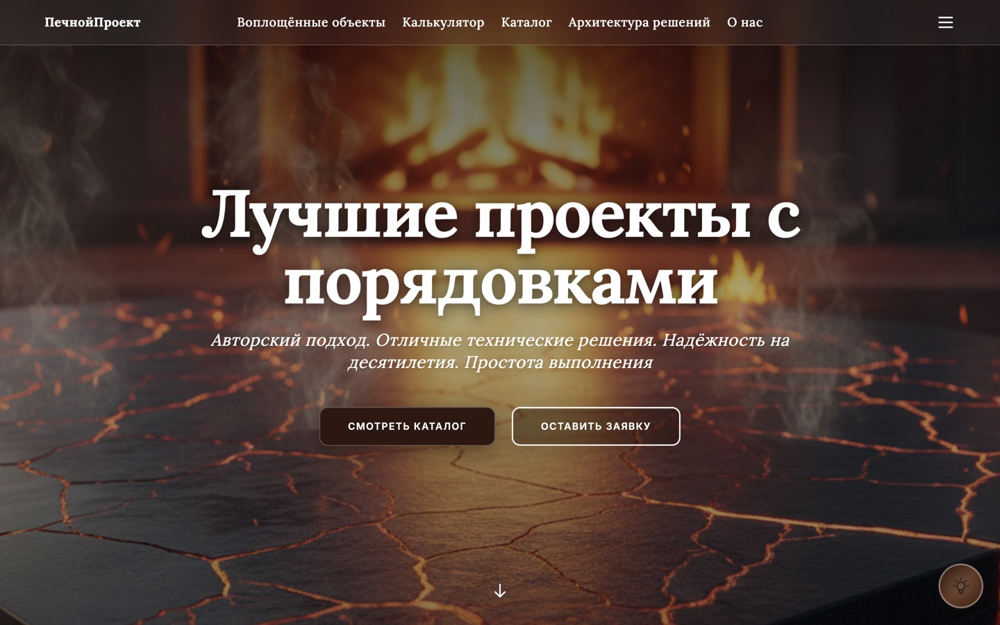
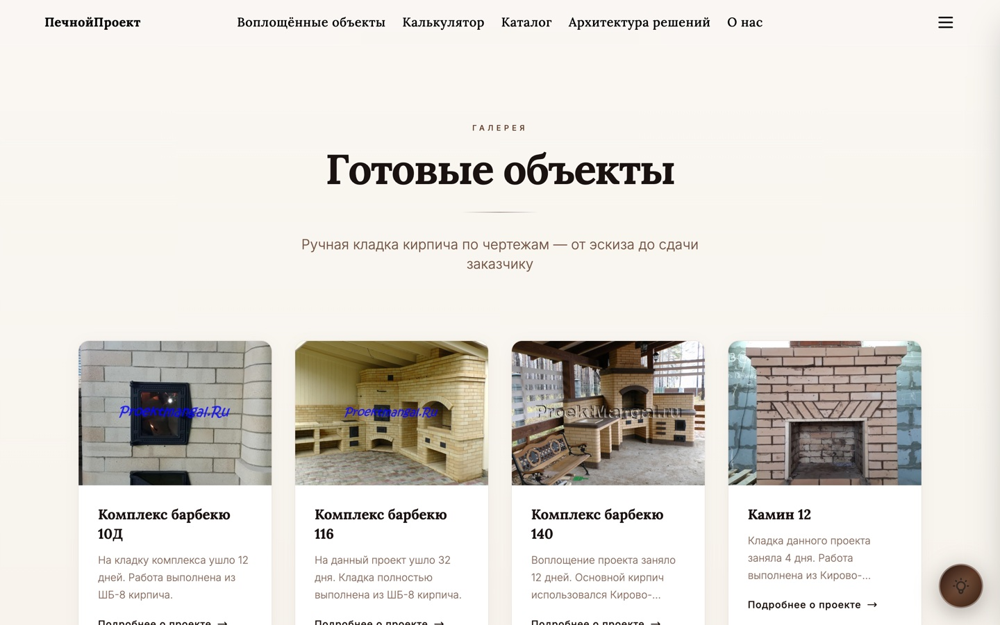
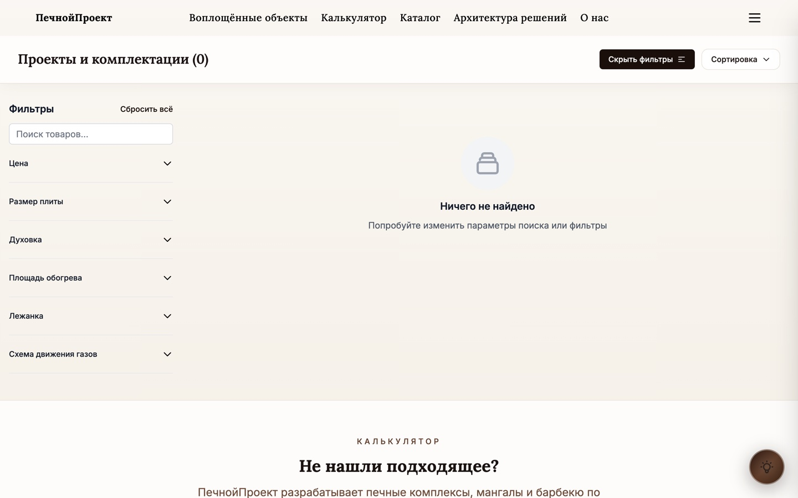
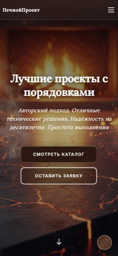

# ПечнойПроект — сайт мастерской печных комплексов

**Каталог печей и каминов с конфигуратором, портфолио реализованных объектов, админкой и генерацией договоров в PDF.**

🔥 Продакшн: https://печнойпроект.рф
🧪 Демо без базы: https://pechnoyproekt.vercel.app

---

## Что внутри

| | |
| --- | --- |
| Публичных маршрутов | 17 |
| Страниц админ-панели | 26 |
| API route handlers | 76 |
| Моделей Prisma | 31 |

**Публичная часть:** главная с hero и калькулятором, `/catalog` с фильтром по категориям, `/portfolio` и его срезы `/portfolio/types/[slug]` и `/portfolio/kladka/[slug]`, `/arhitektura/[slug]`, `/project/[id]`, `/compare`, `/checkout/[projectId]` с `/checkout/success`, `/o-nas`, легальные `/privacy`, `/terms`, `/cookies`, вход и регистрация.

**Контент в базе живёт по девяти направлениям** — камины, отопительные печи, русские печи, банные печи, каминопечи, мангалы, казан-барбекю, большие комплексы и калькулятор барбекю. У каждого направления свой сид-скрипт (см. `package.json`), поэтому наполнение можно пересобирать независимо.

**Админка** (`/admin`, за NextAuth) ведёт каталог, секции и подобласти, hero, шапку, подвал, преимущества, FAQ, отзывы, этапы работ, SEO-тексты каталога, юридические тексты, метаданные сайта и заявки с форм.

---

## Стек

- **Next.js 14.0.4** (App Router) + **React 18** + **TypeScript 5**
- **Tailwind CSS 3.3**
- **Prisma 6.18** + **PostgreSQL**
- **NextAuth 4.24**, credentials-провайдер, пароли на **argon2**
- **nodemailer** — письма с форм
- **pdfkit**, **@react-pdf/renderer** и **puppeteer** — договоры и сметы в PDF
- **zod 4** — валидация форм и API

---

## Скриншоты

Сняты с продакшн-сайта, 1440×900 и 390×844.

| Главная | Портфолио |
| --- | --- |
|  |  |

| Каталог | Мобильная версия |
| --- | --- |
|  |  |

---

## Запуск локально

```bash
npm install
cp .env.example .env      # заполнить DATABASE_URL, NEXTAUTH_SECRET, NEXTAUTH_URL
npm run db:push           # схема в PostgreSQL
npm run db:seed-full      # направления каталога + настройки блоков
npm run dev
```

`NEXTAUTH_SECRET` генерируется через `openssl rand -base64 32`.

Учётную запись администратора сид не создаёт — она заводится из окружения:

```bash
ADMIN_EMAIL=you@example.com ADMIN_PASSWORD='strong-password' npx tsx scripts/create-super-admin.ts
```

Ни адрес сервера, ни логин с паролем в репозитории не хранятся: скрипты создания и обновления админа читают только `ADMIN_EMAIL` и `ADMIN_PASSWORD` и падают с внятным сообщением, если их нет.

---

## Про демо на Vercel

Демо развёрнуто **без базы данных**, и это его главное ограничение: `lib/prisma.ts` строит `PrismaClient` безусловно, а запросы к CMS-блокам обёрнуты в `.catch(() => null)`. Без `DATABASE_URL` страница отдаёт 200 на код-дефолтах, но каталог, отзывы, калькулятор и тексты блоков остаются пустыми — на главной без базы 1423 символа текста против 5406 на проде, и 10 из 12 контентных API отвечают 500.

Чтобы демо было наполненным, нужно указать проекту `DATABASE_URL` на любой PostgreSQL и прогнать `npm run db:push && npm run db:seed-full` против него.

---

## Деплой

**Vercel:** фреймворк определяется автоматически, `postinstall` вызывает `prisma generate`. Нужны `DATABASE_URL`, `NEXTAUTH_SECRET`, `NEXTAUTH_URL` и `NEXT_PUBLIC_SITE_URL`.

**VPS:** `deploy.sh` берёт адрес и путь из окружения и ничего не хранит в себе:

```bash
SERVER_IP=... SERVER_DIR=/var/www/pechnoyproekt SSH_KEY=./deploy_key ./deploy.sh
```

На сервере процесс висит под PM2 (`ecosystem.config.cjs`) за nginx, установка окружения описана в `setup_server.sh`.

---

## Структура

```
pechnoyproekt/
├── app/
│   ├── api/                  # 76 route handlers: публичные + /api/admin/*
│   ├── admin/                # 26 страниц панели контента
│   ├── catalog/ portfolio/ arhitektura/ project/ checkout/ compare/
│   ├── auth/ profile/ o-nas/ cookies/ privacy/ terms/
│   └── layout.tsx            # мета, JSON-LD, шапка и подвал
├── components/               # Hero, Calculator, ProjectsCatalog, ReviewsGallery, FAQ, Footer...
├── lib/                      # prisma, auth, metadata, email, calc-data, parser-data, slug
├── prisma/                   # schema.prisma (31 модель) и seed.ts
├── scripts/                  # сиды по направлениям и обслуживание админов
└── public/                   # изображения и загруженные из админки файлы
```
